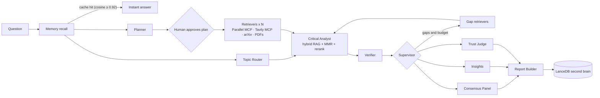

# ResearchForge AI: research you can audit, and that remembers

---

## 1. The problem

- Perplexity, ChatGPT Deep Research and Gemini give a **fresh, confident answer every time**, and you can't check it.
- Citations often point at pages that don't say what's claimed. False premises get answered as if true.
- Nothing is learned: asking the same question tomorrow costs the same time and money again.

---

## 2. The solution

**Answer first, proof underneath, memory forever.**

- A bottom line in 10 seconds, then findings, **each with an exact quote verified in its source**.
- **Several models from different vendors cross-examine** every claim; disagreement is shown, not hidden.
- Unsupported claims go to a visible **"Not established"** list and never into the answer.
- Verified knowledge goes into a **second brain**: ask again and the answer is instant and free.

---

## 3. Architecture

All of this is one LangGraph `StateGraph` with a SQLite checkpointer. Independent work fans out in parallel, and the timeline chart shows the overlap.

---

## 4. The agents

| Agent | Job |
|---|---|
| Memory | Semantic cache, remembered claims, stored evidence chunks: checked **before** the web |
| Topic Router | Profiles the question and routes models: cheap for extraction, stronger for synthesis. IDs and prices are validated live |
| Planner + approval | Subquestions, arXiv queries and the **premise to verify**; pauses for human approval (`interrupt`) |
| Contextual Retriever | Real MCP clients (Parallel, Tavily) plus arXiv, all branches in parallel |
| Critical Analyst | Chunks, embeds, BM25+dense RRF, dedup, rerank, MMR, then quoted claims and counter-quotes |
| Verifier | Code, not an LLM: every quote must exist in its cited source |
| Supervisor | Gaps left and budget remaining? Replan and search again (max 2 loops) |
| Consensus Panel | 2-3 judge models vote supported / contradicted / unclear on every claim |
| Insight Generator | Hypotheses and trends, **clearly labelled speculative** |
| Trust Judge | Faithfulness (entailment) and answer relevance |
| Report Builder | Answer first, corrects false premises, archives everything verified |

---

## 5. The second brain

- **Evidence memory:** every source is chunked (~500 tokens, page numbers kept), embedded locally with `bge-small` (ONNX, free) and stored in **LanceDB**.
- **Claim memory:** each verified claim is stored with its quote, sources, consensus and date. The **Library** tab gives semantic search over everything you've verified.
- **Semantic cache:** the same question reworded returns the stored report in under a second, at $0. **Refresh** forces a fresh search.
- **Session memory:** the LangGraph SQLite checkpointer lets follow-up questions reuse the session's evidence.

---

## 6. Trust and evals

| Signal | How it's measured |
|---|---|
| Citation accuracy | Share of the analyst's quotes found verbatim in the cited source (deterministic) |
| Faithfulness | LLM-as-judge: is each claim entailed by its quotes alone? |
| Answer relevance | LLM-as-judge: do the findings answer the question? |
| Consensus | Share of judge models supporting each claim (with a heatmap) |
| Source credibility | DOI or arXiv, recency, provider, .gov/.edu |

Adversarial checks built into the demo: a **fabricated citation** (caught by the auditor), a **false-premise question** (corrected), and **prompt injection** in web text (sanitized and fenced as untrusted).

---

## 7. Demo flow

1. Ask the question, approve the plan: answer and bottom line first, with consensus badges.
2. Evidence graph and heatmap: where the models agree, and where one disagrees.
3. **Inject fabricated citation:** caught (invalid reference, quote not found).
4. **False-premise question:** "Why have quantum computers already replaced GPUs?" It's corrected.
5. Ask the first question again: **instant, $0, from memory.** Then the Library tab.
6. Trust panel, cost meter, the agent workflow and the parallel timeline.

---

## 8. Roadmap

- **Next:** an NLI cross-check of entailment, citation snowballing (Semantic Scholar/OpenAlex), staleness re-verification, a "what changed since last time" diff.
- **v1 public:** golden-set evals in CI, bring-your-own-key hosting, auth, budget caps, shareable reports.
- **Future:** a watcher agent with alerts, figure and table reading in PDFs, chat with your library, a public verified-claims API.
