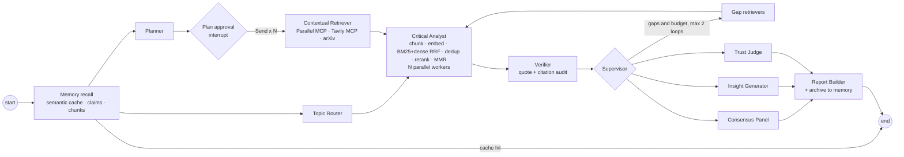

# ResearchForge AI: research you can audit, and that remembers

**Outskill AI Engineering Accelerator Program, C10 Hackathon | Group 6**

**Topic 4: Multi-Agent AI Deep Researcher**, our product: **ResearchForge AI**

- Live app: [researchforge-ai on Streamlit](https://researchforge-ai-etwukejycdk9qqgpuyejkb.streamlit.app/) (bring your own OpenRouter key in the sidebar)
- Repository: [nkandagatla/researchforge-ai](https://github.com/nkandagatla/researchforge-ai)

## Authors

- Kiran Viradiya
- Deigratia Daniels
- Nithin Kumar Kandagatla
- Roland Johnson
- Fnu Heero


Every claim is quoted and checked against its source, cross-examined by several models, and visualised. Everything verified goes into a local **second brain**, so asking again is instant and free, and related questions start from what you already know.

## Setup (Windows PowerShell, Python 3.11-3.14)

```powershell
cd claude-v2-generation
py -m venv .venv
.venv\Scripts\Activate.ps1
pip install -r requirements.txt          # binary wheels only, including on Python 3.14
copy .env.example .env                    # then add your keys
python -c "import memory; memory.warmup()"  # one-time ~150 MB download of the local ONNX models
streamlit run app.py
```

| `.env` key | Needed | Purpose |
|---|---|---|
| `OPENROUTER_API_KEY` | yes | All LLM calls. The model list and prices come live from openrouter.ai (no key needed for that) |
| `OPENROUTER_MODEL` | no | Default extraction model (`openai/gpt-4o-mini`) |
| `TAVILY_API_KEY` | recommended | Tavily MCP |
| `PARALLEL_API_KEY` | no | Parallel MCP (also works keyless at a lower rate limit) |
| `LANGSMITH_API_KEY`, `LANGSMITH_PROJECT` / `LANGFUSE_PUBLIC_KEY`, `LANGFUSE_SECRET_KEY`, `LANGFUSE_HOST` | no | Tracing to either or both, off by default. Turn it on with the sidebar toggle or `run_cli.py --trace` to get trace links |
| `HF_TOKEN` (or `HF_API_KEY`) | no | Faster, authenticated downloads of the ONNX models |
| `RF_BUDGET_USD` | no | Spend cap for the supervisor's extra search loops (default 0.25) |

Keys go only in `Authorization` headers and are redacted from errors and traces. Memory lives in `.memory/` (LanceDB, plus the LangGraph SQLite checkpoints); models live in `.models/`.

## Headless runner (shared contract)

```powershell
python run_cli.py --question "How is quantum computing going to change the current AI LLM/models and agentic implementations?" --out runs\q1 --warmup
python run_cli.py --question "How is quantum computing going to change the current AI LLM/models and agentic implementations?" --out runs\q1-again
```

This writes `report.md` and `metrics.json` with exactly the contract keys. The second run is a semantic-cache hit. `--refresh` ignores the cache, `--max-loops N` sets the supervisor's loop limit (default 1, maximum 2), `--warmup` loads the ONNX models before the timer starts, and `--trace` sends the run to LangSmith and/or Langfuse.

## Architecture



| Module | What it owns |
|---|---|
| `models.py` | Pydantic contracts and the LangGraph state (reset-able list reducers, so a session's checkpoint carries over between questions) |
| `tools.py` | All external I/O: OpenRouter (catalogue, prices, structured LLM calls with JSON fallback and caching), real MCP sessions, arXiv, page-numbered PDFs |
| `memory.py` | fastembed `BAAI/bge-small-en-v1.5` embeddings, `ms-marco-MiniLM` cross-encoder, ~500-token chunking, and the LanceDB tables (chunks, claims, reports), with numpy + SQLite behind the same interface as a fallback |
| `evidence.py` | Deterministic logic: dedup and stable ids, BM25, RRF, MMR, near-duplicates, fenced context, quote verification, consensus, credibility, trust metrics, the Markdown report |
| `agents.py` | The 13-node graph, the router rules, the SQLite checkpointer and the `research()` runner shared by the UI and the CLI |
| `app.py` | The Streamlit UI and the 8 Plotly figures (pure functions, unit-tested) |

## Features in brief

- **Answer first:** premise check, bottom line, summary, metrics, then the trust panel. Quoted findings follow, then hypotheses (labelled), then "Not established".
- **Memory:** a near-identical question (cosine ≥ 0.92) returns the stored report instantly, with a **Refresh** button. Related questions get "Already in your library" claims and memory chunks as evidence. The History tab's **Verified Claims Library** view gives semantic search over every verified claim.
- **Retrieval:** chunk, embed, embedding near-duplicate removal (≥ 0.95), BM25 + dense fused by RRF, cross-encoder rerank of the top 24 (LLM rerank if the model can't load), MMR with λ = 0.7 down to 8 chunks per subquestion.
- **Integrity:**
  - an exact quote per claim, verified in the source (tolerant of whitespace, entities, escapes and `...` gaps);
  - Contested status with counter-quotes;
  - unsupported or judge-contradicted claims go to "Not established";
  - web text is sanitized and fenced as `<untrusted_source>`.
- **Trust panel:** faithfulness (LLM entailment judge), answer relevance, citation accuracy, consensus, and source credibility (DOI/arXiv, recency, provider, .gov/.edu).
- **Agent Activity:**
  - the agent-to-agent workflow graph;
  - a **Recharts** bar chart of average latency per research agent (Planner, Retriever, Analyst, Verifier, Reporter), this run vs the average of all past runs, with the bottleneck flagged;
  - a **Recharts** line chart of **citation accuracy over time** across research sessions (cache hits excluded), with the running average as a dashed reference line;
  - the parallel timeline.

  The chart loads React and Recharts from pinned jsDelivr builds, and says so plainly if they can't load.
- **Evidence:** the evidence graph plus a **citation heat map** (claims x sources: supporting quote, counter-quote, citation counts per source).
- **History:** a toggle switches between **Deep Research Sessions** (every finished run, logged to `.memory/history.jsonl` with time, findings, consensus, citation accuracy, cost and per-agent latency; past reports can be reopened) and the **Verified Claims Library** (semantic search over every verified claim). Both trend charts read from this log.
- **Demos:** **Inject fabricated citation**, and **False-premise question** (the planner extracts the premise and the report corrects it).

## Tests

```powershell
ruff check . ; mypy ; pytest                 # offline: LLM, MCP, arXiv and the ONNX models are all mocked
pytest -m integration -s                      # LIVE: MCP discovery, the <90 s run, the <5 s cache hit, the false premise
```

See [STATS.md](STATS.md) for counts, [PRESENTATION.md](PRESENTATION.md) for the pitch and [DEMO.md](DEMO.md) for the 3-minute demo.
